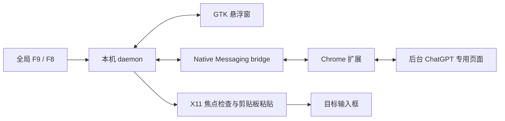

# 架构与目录

daemon 在登录时启动，监听按键、管理悬浮窗、启动 Chrome 和粘贴文字。bridge 使用标准库，把 Chrome Native Messaging 消息转接到本机 daemon。扩展负责专用页面、听写状态、取消与转写结果；页面脚本通过 DOM 操作听写按钮并观察状态变化。

F9 开始时记录目标 X11 窗口和焦点；结束后等待结果，检查目标再粘贴。录音达到 8 分钟自动结束。F8 取消当前任务。关闭听写时取消任务、关闭专用页面与悬浮窗，并保留 F9 待唤醒监听；它并不是退出所有进程。

| 文件 | 作用 |
| --- | --- |
| `manifest.json` | Chrome Manifest V3 配置及权限 |
| `background.js` | 听写流程、取消、录音上限、结果和原生通信 |
| `chatgpt-page.js` | 页面按钮与编辑器识别、状态观察、草稿保护 |
| `target.js` | 网页插入后备路径和选区保护 |
| `popup.html` / `popup.js` / `style.css` | 扩展面板 |
| `native/daemon.py` | F9/F8、悬浮窗、音量、粘贴、Chrome 启动与日志 |
| `native/bridge.py` | 标准库 Native Messaging 转接 |
| `native/overlay.py` | GTK 悬浮窗、菜单、状态与拖动 |
| `native/install.py` | 当前用户的安装、更新和卸载 |
| `package.py` | 白名单打包源码与使用文档 |
| `tests/smoke.mjs` | 隔离 Chrome 中的快速回归 |
| `tests/real/` | 真实语音与桌面验收脚本 |
| `tests/launch/` | 嵌套 X 会话中的 Chrome 启动检查 |

扩展只申请 ChatGPT 的站点权限，网页插入后备使用 activeTab。本机桌面路径使用全局键盘监听、剪贴板和模拟粘贴，因此具备桌面输入权限。服务使用当前用户的本地通信；部署时应保留用户目录权限。

最近 10 条转写只留在运行内存中。项目不把音频写入磁盘，但语音会经 ChatGPT 网页发送到服务端；调试日志和状态文件仍需作为用户数据对待。
