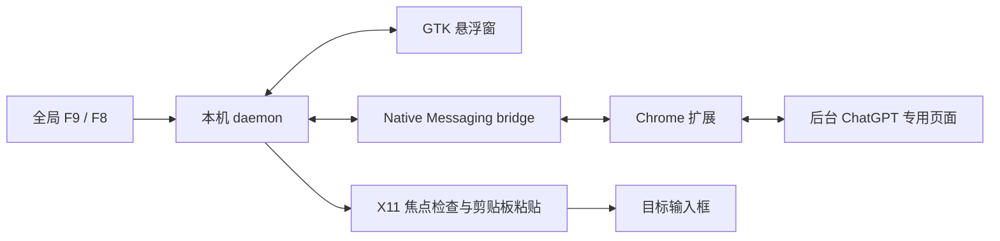

# 架构与目录

## 目录

- extension/background/index.js：听写主流程、上限、取消、专用页面和通信。
- extension/content/：ChatGPT 页面适配及网页插入保护。
- extension/popup/：扩展初始化与诊断面板。
- native/dictate/daemon.py：单事件循环与会话协调。
- native/dictate/hotkeys.py：按键默认值及目标焦点规则。
- native/dictate/clipboard.py：纯文本剪贴板访问。
- native/dictate/audio.py：可选的音量检测。
- native/dictate/panel.py、overlay.py：悬浮窗进程及 GTK UI。
- native/dictate/config.py：共享运行路径和默认配置。
- native/dictate/protocol.py、bridge.py：JSON 行和 Chrome 长度前缀消息。
- native/dictate/install.py、doctor.py、cli.py：安装事务、只读诊断和命令。
- scripts/：源码与发行包入口及开发检查。
- tests/unit、integration、manual：纯逻辑、模拟网页、真实桌面验收。

F9 开始时记录 X11 目标，结束后检查窗口和焦点再粘贴。F8 取消。关闭听写会取消任务、关闭页面和面板，但保留待唤醒 F9。近期转写只在内存；语音通过 ChatGPT 网页传给服务端。

本轮保持现有事件循环和听写状态机，拆出边界清晰的功能。后续仍可分解后台 JS 和 daemon 中的协调逻辑；不把目录整理视为全面重写。

## 通信

Chrome 到 bridge 使用 4 字节小端长度前缀 JSON；bridge、daemon、panel 使用 UTF-8 JSON 行。协议沿用既有 desktop-command、状态、插入及菜单消息。进一步版本化与状态机契约测试列入后续路线图。
